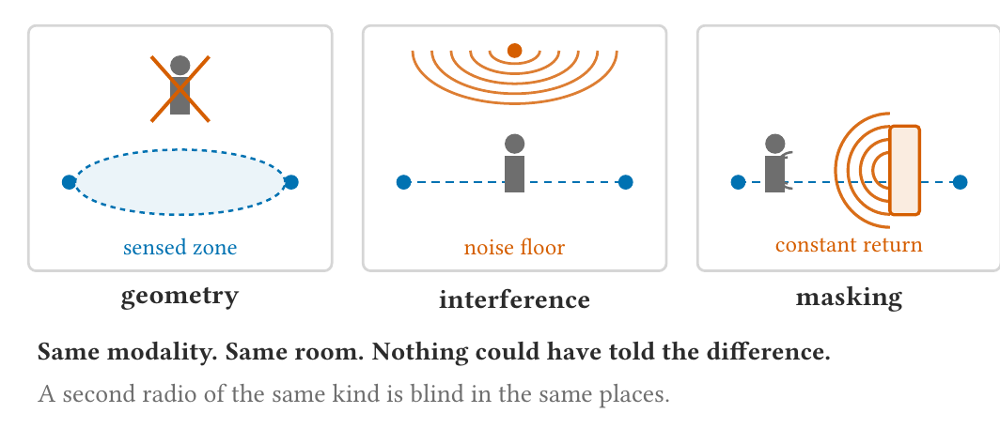
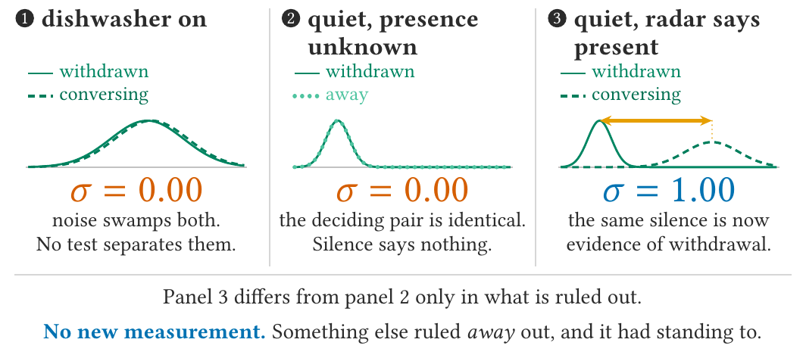
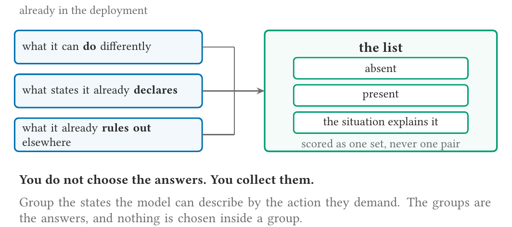
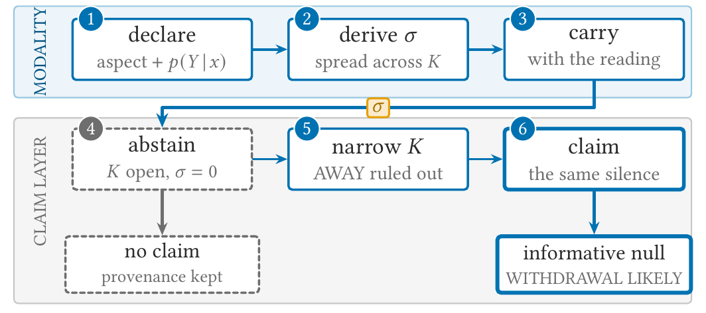

# Model-derived Standing

Whether a sensor reading was **entitled** to count as evidence, computed from the model and the
conditions rather than from the values.

A system accounts for **yield** at the sensor and rarely for **entitlement** at the claim. A
reading that arrived and a reading that could have discriminated are different objects, and only
the second is evidence.



σ(𝒮, C) is the minimum, over pairs of open answers, of the squared Hellinger distance between the
laws they predict for the decision statistic. None of the mathematics is new. What is new is
where it is computed, per view and before fusion, and where it is carried, with the claim across
the module boundary.

Artefact behind *Model-Derived Standing: Separating Evidence from Blindness in Sensing Systems*.
Private, unreleased.

## Does this help your case?

σ answers one question: **can this view's statistic separate these answers, under these
conditions?** It answers it correctly. Every way this goes wrong is the question not being the one
you meant, so place your case first.

| your situation | does it help |
|---|---|
| blindness comes from something that CHANGES: interference, occlusion, a dead channel | **yes, the strong case.** σ moves with the conditions, so you learn per interval which views count |
| blindness comes from the STATE being determined: a still occupant looks like an empty room | **at design time.** Conditions are identical every interval, so σ cannot vary. It tells you no amount of that modality will help, which is a purchasing decision |
| your claim is about a HISTORY, "did anyone leave", not a state | **not yet.** Restate at window level over trajectories first; a state-level answer set cannot express it |
| your claim is DERIVED from another claim | **partly.** σ does not compose along a chain. Use the certificate rates: size is a maximum, coverage deficit is a sum |
| you want to REFUSE a verdict | **yes, and provably** |
| you want to LICENSE one | **no.** Unrefused means not-yet-refused, never entitled |

Three things stay yours: the **action map** (two situations differ iff you would act
differently), the **forward model**, and the **floor**. Get the action map wrong and σ is
arithmetic on the wrong partition, computed perfectly. Only that one can be checked, and only
against your own policy:

```python
report = quotient_check(answers, alarm_policy, states)   # would the consumer act differently?
if not report.agrees:
    print(report.reason())    # 'still' and 'moving' are both 'occupied', but the policy differs
```

It settles whether your answer set is coarser than your deployment. Whether the policy is right
is a question about the world, and nothing settles that.

Full contract, seven conditions with which are checked, which are recorded and which are
declared, in `docs/standing-scope-v4.md` of the paper repository.

## What σ says



The same silence, three times. Twice nothing could have told the difference, and once something
could. Only the third is evidence, and no confidence score distinguishes the three.

## Install

Python 3.10+, numpy only at runtime.

```bash
pip install -e ".[dev]"     # dev adds pytest and hypothesis
pytest                      # 367 tests
```

## Use

```python
from standing import AnswerSet, Conditions, sigma, decide

answers = AnswerSet.from_actions(states, action_for)     # the quotient, see below
conditions = Conditions({"windows_reporting": 24})       # conditions, never readings
result = sigma(answers, MyModel(), conditions, statistic="window_mean")
ruling = decide(result, floor=0.25)                      # admissible / carry / abstain
ruling = decide(result, floor=0.25, certificates=certs)   # admitted, if the certificates clear it
```

`MyModel` is yours: one method, `law(answer, conditions)`, returning anything with
`.sample(size, rng)`. It must predict the statistic your pipeline **actually decides on**, not the
raw sensor values.

### Answers are collected, not chosen



Group the states your model can describe by the action they demand. The groups are the answers,
and they come out as regions rather than points, which is what stops the criterion degenerating.

### What the quotient can hide

σ is a minimum over pairs of **answers**, so it sees only the law of each group. A state inside
one answer can be indistinguishable from a state inside another while the group laws still
differ, so σ clears the floor and every verdict resting on that pair is admitted unentitled.

```python
audit = quotient_audit(
    answers, MyModel(), conditions,
    floor=0.05,     # the admission threshold the claim faces
    delta=0.25,     # mass floor: a collapse must carry real weight
    states={"no-alarm": {"empty": EMPTY},
            "alarm":    {"still": STILL, "moving": MOVING}},
    result=result,
)
if audit.laundered:         # admitted, and resting on a pair it cannot separate
    print(audit.reason())
```

You supply the states and their labels; the audit will not guess them. `delta` is required: on a
discretised state space the two states either side of an action boundary sit in different answers
by construction, so scoring single states makes `laundered` true at every resolution. Read δ as a
ladder, at δ = 1 the audit recovers σ, and quote neither `sound` nor `laundered` without both the
floor and the δ.

On a motion-only view over `{empty, occupied_still, occupied_moving}`: σ is **0.2537** and the
ruling is admit at a floor of 0.05, while `(empty, occupied_still)` scores **exactly zero**, and
structurally. Positive verdicts are entitled, negative ones are not.

Two honest responses to a collapse: restate the claim over a finer action map, or accept that it
is **directional**, since a view can be entitled to say yes and never to say no.

### The five dispositions, and what crosses the boundary



| σ | rule | meaning |
|---|---|---|
| ≥ floor, no certificate | **admissible** | clears the floor on the model alone; may be carried, may not be relied on |
| ≥ floor, and a certificate scored on held-out **readings** (`source="readings"`) ≥ floor for every open pair | **admitted** | may be used as evidence, and a stranger can check why |
| ≥ floor, and the certificate was scored on the model's own samples (`source="model"`) | **admissible** | the library checked against its own law; recorded, and admits nothing |
| lifted over the floor by an anchor ruling an answer out | **recruit** | the question narrowed; the data did not change |
| 0 < σ < floor | **carry** | identifiable but not here; pass it on with its standing |
| exactly 0 | **abstain** | nothing that is a function of the readings separates the answers, at any sample size |

Abstention at a threshold is a policy you must defend. Abstention at exactly zero is a theorem you
need not.

### Auditing a verdict: every way it can be wrong, as a check

A ruling is a number against a floor. The procedure that produced it has five steps, and each
fails in its own way: the answers do not match the actions or leave a covered state out, the
conditions are wrong or the regime moved under them, the law is wrong or omits states, the
comparison is over a statistic the decision does not use, the verdict is taken as licence or
refuses more than it need. `audit` runs one check per failure mode and returns them all, **run or
not**:

```python
from standing import audit, Probe

report = audit(
    ruling,
    answers=answers, model=MyModel(), conditions=conditions,   # what sigma was scored on
    against=reference_conditions,        # step 2: the same answer against itself across the gap
    policy=action_for, states=None,      # step 1: the quotient, over the model's own states()
    probes=[Probe("light", "switch the room light on", predicted=law, observed=readings)],
    fine=(finer_answers, FinerModel()),  # step 3: a richer vocabulary can only lower sigma
    perturbations=[OtherLaw()],          # step 3: T14, a zero may not flip
    misses=[{"state": "still", "sigma": 0.31}],  # step 1: what the claim covered and missed
    result=result, decision_statistic="window_mean",            # step 4: T15
    certificates=certs,                  # step 5: the rule a stranger can re-apply
)
report.grade         # "admitted (7 of 11 checks run, all passed)"
report["reference"]  # Check(status="passed", reason="same-answer null 0.0047 ...")
report.not_run       # the checks that could not run, each naming what it needed
```

Every input is optional. A check without its inputs reports `not_run` and says what it needed,
because the absence of a check is something a consumer must see and it is not the same as a check
that passed. The grade reads the rule and the checks together: `refused, structural` for a zero,
which needs no audit to be trusted because omission can only inflate σ; `admissible, unverified`
for a floor cleared on the model alone; `admitted (k of n checks run, all passed)`; and
`contested` when a check that ran failed. `Record.build(..., checks=report)` carries the audit
with the verdict, which is the provenance a consumer can act on.

| check | step | it catches | it needs |
|---|---|---|---|
| `quotient` | 1 | answers that are not the partition the consumer acts on (T13) | the policy |
| `question` | 1 | σ exactly zero for every view: the answers touch, or nobody was built to see this | every view |
| `scope` | 1 | a miss on a state the model never described, or misses that all sit where σ cleared the floor | the misses |
| `reference` | 2 | the same answer against itself across the gap in conditions reaching σ: the conditions alone explain the separation | a reference period |
| `probe` | 3 | the law against what happened when someone acted on it | an action and its outcome |
| `vocabulary` | 3 | a finer model that revokes the admission, or one that is not a refinement | a finer model |
| `stability` | 3 | a zero that flips, or a magnitude that crosses the floor, under laws the author calls equally plausible, all reading the ruling's locus map (T14) | perturbed models |
| `merge` | 3 | a zero that an alternative locus map splits: the refusal rests on a merge the author wrote, which T14 never tested | alternative maps as `(answers, model)` |
| `statistic` | 4 | σ scored on a statistic the decision does not read (T15) | the decision's statistic name |
| `seed` | 4 | Monte Carlo noise that alone moves σ across the floor | nothing more |
| `certificate` | 5 | admission resting on the model alone (T10), including a certificate scored on the model's own samples | held-out readings |

`coverage_report(rulings)` is the other direction of step 5: how often the view was allowed to
speak, over a run, because a verdict that refuses too much is safe and its cost shows only in
aggregate.

What no check catches is a condition instrument that is wrong and consistent with the reference.
That is the one silent failure left, and it is the reason conditions come from instruments and not
from assumptions.

## Auditing from outside

Every number in the JSON record re-derives from the record itself, so a consumer can check a claim
**without the model and without the data**. The record carries what was DECLARED as well as what
was computed: which partition the claim was scored over and whether anyone ran the policy against
it, whether the quotient was audited and what it found, whether the claim is derived from another
and how deep, and the window a verdict with memory rests on. Each defaults to
`None`, and **`None` means not declared rather than clean** — a claim nobody audited must not look
like one that was audited and passed.

```bash
standing verify record.json --strict
standing report records/*.json      # deployment-level rates
```

## What it refuses

Each refusal exists because a deployment made that mistake and got a plausible number nobody
questioned.

| You cannot | because |
|---|---|
| pass a sequence to `combine_replicates` | replicates use an exponent, heterogeneous views a product; a deployment overstated by **2.49×** |
| `combine_views` on views sharing a statistic | σ is not aspect-decomposable: each aspect scored **0.0000** where the joint was **0.4288** |
| score a threshold on the sample that chose it | that is a fit; it returned **0.9896** on a null where both sides were the same answer |
| put a reading in `Conditions` | σ must not depend on values, or it stops existing for silent intervals |
| build a one-answer set, or two answers for one state | a synonym drags σ to zero (**0.1534 → 0.0000** in the field) |
| read `.sigma` off a `Weight` | a product of factors cannot say what T1, T2, T6 and T10 say |
| give an `Anchor` a bare number | a hand-typed 0.99 turned a carry into an admitted recruit, and the record verified clean |
| record an answer set the ruling was not made over | provenance for the wrong partition is worse than none |

## Trust, and its limit

- **The theorems are executable.** Every assertion in `tests/test_theorems.py` is a proposition
  from the paper. A failure there is a claim being false.
- **The estimator is scored against closed forms,** never against itself.
- **The invariants are searched, not sampled**, with Hypothesis.
- **Mutation tested**, most recently 33 mutants over the quotient check with 4 survivors, each a
  real coverage gap rather than an equivalent mutant, each now killed.
- **The limit, stated plainly.** Every instrument above scores the library against itself or
  against a closed form of its own model. A deliberately misspecified forward model overstated σ
  by **8.66×** and passed all six diagnostics clean. Until there is a test against data the
  library did not generate, that gap is structural rather than a matter of coverage.

## Layout

```
src/standing/   numerics divergence answers model sigma certify drift rules checks record weight cli
tests/          theorems, properties, packaging, and *_cml.py against the live deployment
examples/       toy_pipeline.py, a complete run end to end
```

`AGENTS.md` has the invariants, the bug log, and which fixes rest on a single assertion.
