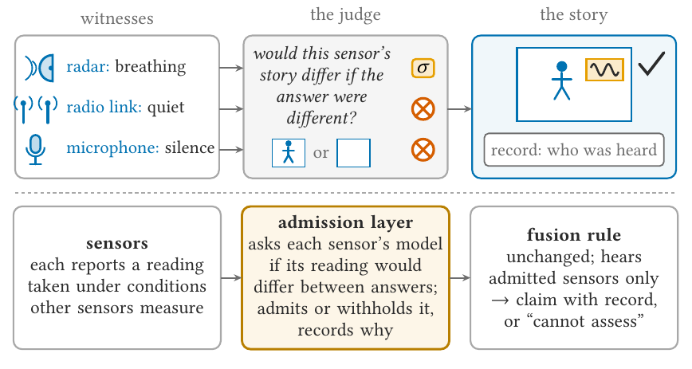
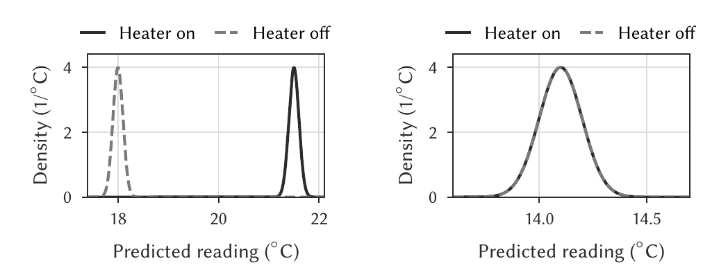

# Model-derived standing

A small Python library (numpy only) that tells a sensing pipeline whether a sensor's reading was entitled to count as evidence.

## What is standing?

Pipelines that fuse several sensors read a quiet sensor as evidence that nothing happened. Often the sensor was quiet because it could not have seen. A WiFi link reads the same for an empty room and for a person sitting still. A thermometer reads the same with the heater on or off while the window is open. A microphone reads the same for an empty home and for a person who has withdrawn. Every quantity a pipeline keeps about its sensors, such as confidence, reliability and yield, describes the data that arrived, so all of them look fine in exactly these cases, and the wrong answer leaves the pipeline with full confidence.

Standing is the missing quantity. A sensor has standing on a question when its reading would have differed had the answer been different, under the conditions of this interval. It is computed from the sensor's model and the measured conditions, never from the reading itself, so it exists even for an interval in which nothing arrived.



## When to use?

- You fuse several sensors into one claim and act on absence: an occupancy estimate that switches ventilation, a home monitor that reads a silent day, a condition monitor that scores a machine as healthy.
- A sensor's silence can mean two things in your deployment, nothing happened or nothing could have been seen, and your pipeline cannot tell them apart.
- You want a third output beside yes and no, "cannot assess", with a reason attached, instead of a confident wrong answer.
- You want to know which sensor to add, or which probe to run, to restore the answer.

## What it provides

- `sigma`: standing per sensor and per pair of answers, from a forward model you write (one method, `law(answer, conditions)`), the measured conditions, and the statistic your pipeline actually decides on.
- `decide`: admit a sensor for the pairs it can separate, withhold it from the rest, and return "cannot assess" when no sensor is admitted.
- A record for every ruling (sensor, question, pair, verdict, reason, conditions, model version) that travels with the claim and can be checked by someone else.
- Guards that refuse what cannot be meaningful: one-answer sets, synonymous answers, thresholds scored on the sample that chose them, and conditions that are readings in disguise.



The same instrument, two conditions. With the window closed the two answers predict different readings and the thermometer has standing. With the window open they predict the same reading, and no number of readings can tell the answers apart.
- Numbers: `standing.continuous` gives standing at the resolution the consumer acts on, with exact zeros where the reading is insensitive to the quantity.

## Example

```python
from standing import AnswerSet, Conditions, sigma, decide

answers = AnswerSet.from_actions(states, action_for)   # group states by the action they demand
conditions = Conditions({"windows_reporting": 24})     # measured conditions, never readings
result = sigma(answers, MyModel(), conditions, statistic="window_mean")
ruling = decide(result, floor=0.25)                    # admit, carry, or abstain, with a record
```

`examples/toy_pipeline.py` runs a complete pipeline end to end: answers read off the actions, a forward model, conditions, standing before fusion, a certificate from a split sample, and the record.

## What it is not

Standing does not make a sensing system detect better. It makes a working system say only what it is entitled to say, and record why. It needs a forward model per sensor, and it cannot see a state that the model does not describe.

## Install

Python 3.10 or later.

```bash
pip install -e ".[dev]"   # dev adds pytest and hypothesis
pytest
```

## Layout

```
src/standing/   answers, model, sigma, continuous, rules, certify, record, checks, audit, cli
tests/          the theorems as tests, properties, packaging, and the deployment comparisons
examples/       toy_pipeline.py, a complete run end to end
```

Apache 2.0 licence. The paper that introduces standing is under review.
